# 🛠️ In-House PCB Fabrication — AC-to-DC Five-Channel IR LED Driver

  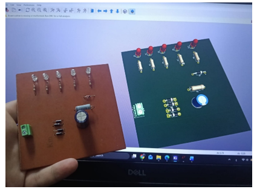

  
  
  
  
  

---

## 🔄 Complete Hardware Engineering Lifecycle

This repository documents the **end-to-end hardware realization cycle** of a custom single-layer PCB—from circuit simulation to a powered, verified physical board—with a primary focus on **in-house manual PCB manufacturing**.

~~~text
[1. Circuit Simulation] --> [2. PCB Layout & DFM] --> [3. In-House PCB Fabrication] --> [4. Bring-Up & Testing]
        (LTspice)                  (KiCad)               (Toner Transfer -> Assembly)         (DMM Verification)
~~~

**Target Application:** A compact, Zener-regulated AC-to-DC power supply ($17\text{ V}$ peak / $50\text{ Hz}$ AC input to $9.1\text{ V}$ DC regulated output) driving five parallel infrared LED channels (~$18.8\text{ mA}$ per branch).  
> 📄 *For full circuit analysis, design equations, and BOM justification, see [`LED_Driver_PCB_Report.pdf`](LED_Driver_PCB_Report.pdf).*

---

## ⚙️ Board Fabrication Specifications

| Parameter | Specification |
| :--- | :--- |
| **Board Type** | Single-layer Copper-Clad Board |
| **Component Technology** | 100% Through-Hole (THT) |
| **Transfer Method** | 1:1 Mirrored Laser Print & Heat Toner Transfer |
| **Etchant** | Ferric Chloride ($\text{FeCl}_3$) |
| **AC–DC Creepage / Clearance** | $\ge 2\text{ mm}$ (per IEC 60950) |
| **Drill Bit Sizes** | $0.8\text{ mm}$ – $1.0\text{ mm}$ |
| **Post-Assembly Cleaning** | Isopropyl Alcohol (IPA) |

---

## 🖥️ Stage 1 — Pre-Fabrication Simulation (LTspice)

Before committing the design to copper, the circuit was verified in **LTspice** (`.tran 0.5`) to confirm full-wave rectification, capacitive smoothing (~$0.2\text{ V}_{\text{p-p}}$ ripple), $9.1\text{ V}$ Zener regulation, and safe LED branch current (~$18.8\text{ mA}$ per LED).

<table>
  <tr>
    <td align="center" width="50%">
      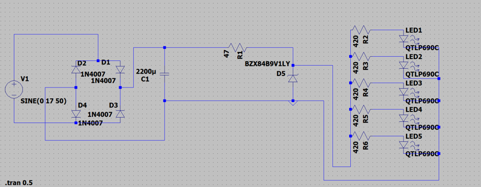 
      <em>LTspice Schematic</em>
    </td>
    <td align="center" width="50%">
      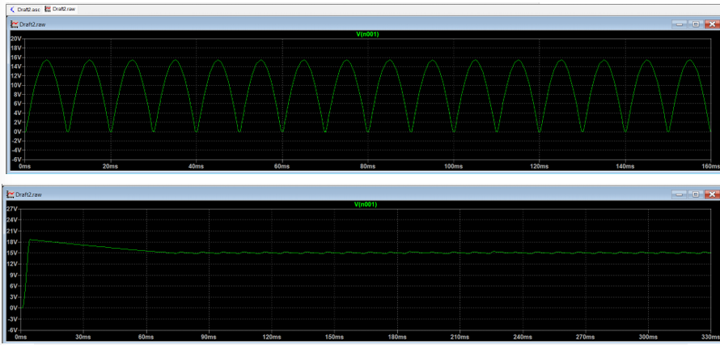 
      <em>Rectified &amp; Filtered DC Bus (V_cap)</em>
    </td>
  </tr>
  <tr>
    <td align="center" width="50%">
      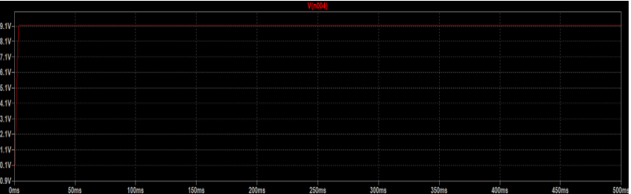 
      <em>Regulated Zener Output (9.1 V)</em>
    </td>
    <td align="center" width="50%">
      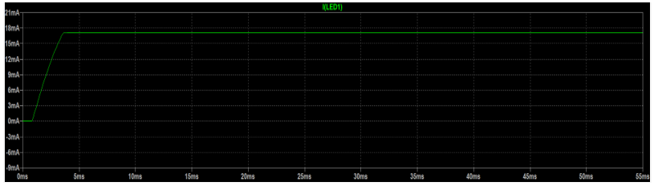 
      <em>LED Branch Current I(LED1)</em>
    </td>
  </tr>
</table>

---

## 📐 Stage 2 — PCB Layout & DFM for Home Fabrication (KiCad)

The schematic was converted into a **manufacturable single-layer PCB** in KiCad using Design for Manufacturing (DFM) rules tailored for manual toner transfer and hand-drilling:

- **Wide tracks & generous pads** to prevent copper lifting during manual drilling and hand-soldering.
- **Zero-jumper single-layer routing** on the bottom copper layer, keeping all THT components cleanly aligned on the top side.
- **Thermal & high-current placement:** Series resistor `R1` and $1\text{ W}$ Zener `D5` grouped closely to shorten high-current traces.
- **Safety isolation:** AC input traces separated from regulated DC rails by **$\ge 2\text{ mm}$**, terminating at an edge-mounted $5.08\text{ mm}$ screw terminal block.
- **Symmetrical LED array** with custom copper lettering (`SEIF M ELDABY`, `DR: KHALIL ISMAEEL`, `Faculty of Engineering`).

<table>
  <tr>
    <td align="center" width="33%">
      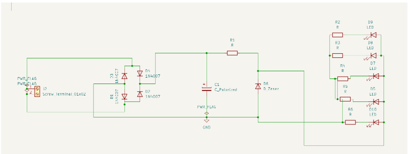 
      <em>KiCad Schematic</em>
    </td>
    <td align="center" width="33%">
      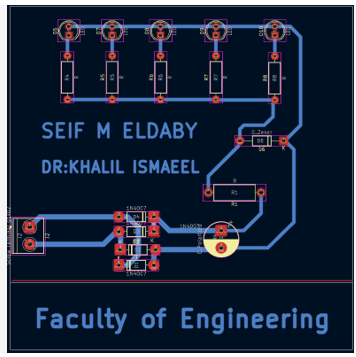 
      <em>Copper &amp; Silkscreen Layout</em>
    </td>
    <td align="center" width="33%">
      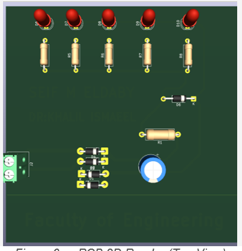 
      <em>3D Model Verification</em>
    </td>
  </tr>
</table>

---

## 🏭 Stage 3 — In-House PCB Fabrication Pipeline (Step-by-Step)

This is the core physical realization phase—transforming a blank copper-clad sheet into a fully assembled, working PCB entirely by hand.

### 3.1 Substrate Preparation & Print-Ready Artwork
A blank copper-clad board was cut to exact dimensions, lightly abraded, and degreased for maximum toner adhesion. The bottom copper layer was exported at **1:1 scale (mirrored)** and printed onto glossy paper using a laser printer.

<table>
  <tr>
    <td align="center" width="50%">
      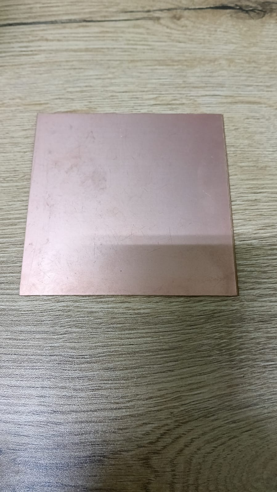 
      <em>Step 1a — Cleaned blank copper-clad substrate</em>
    </td>
    <td align="center" width="50%">
       
      <em>Step 1b — 1:1 mirrored bottom-layer artwork ready for laser printing</em>
    </td>
  </tr>
</table>

---

### 3.2 Toner Transfer & Chemical Etching ($\text{FeCl}_3$)
The laser-printed layout was heat-transferred onto the copper board using an iron, then submerged in a **Ferric Chloride ($\text{FeCl}_3$)** bath with continuous agitation to dissolve all exposed copper while the fused toner protected the circuit traces and lettering.

<table>
  <tr>
    <td align="center" width="50%">
      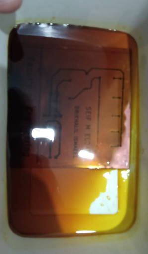 
      <em>Step 2a — Active chemical etching in Ferric Chloride solution</em>
    </td>
    <td align="center" width="50%">
      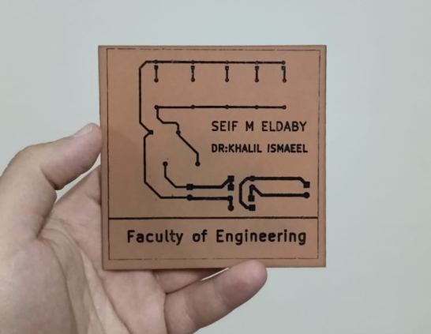 
      <em>Step 2b — Etching complete with protective toner mask intact over tracks</em>
    </td>
  </tr>
</table>

---

### 3.3 Toner Stripping & Visual Trace Inspection
The toner mask was stripped away with **Acetone/Thinner** to expose the clean copper traces. Every track and pad was visually inspected for breaks, pinholes, or unwanted copper bridges.

  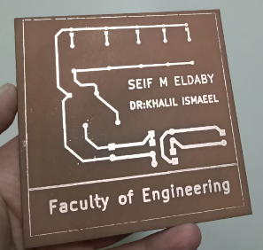
   <em>Step 3 — Bare etched copper tracks and lettering after toner removal</em>

---

### 3.4 Pre-Drill Electrical Continuity Testing
Before drilling, every net was probed using a **Digital Multimeter (DT9205A)** in continuity mode to verify zero open circuits and zero shorts between neighboring tracks.

  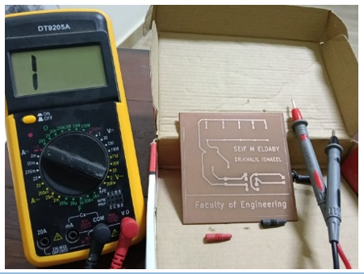
   <em>Step 4 — Verifying trace electrical integrity before drilling</em>

---

### 3.5 Precision Through-Hole Drilling
Component holes were drilled using a mini drill press with **$0.8\text{ mm}$ – $1.0\text{ mm}$** bits matched to the lead diameters of the diodes, resistors, capacitor, LEDs, and screw terminal.

  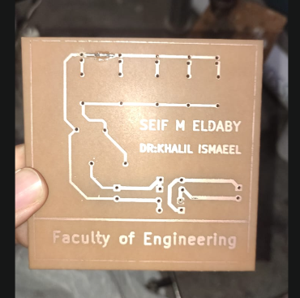
   <em>Step 5 — Drilled pads ready for component placement</em>

---

### 3.6 Component Kitting & Assembly Preparation
All through-hole components (1N4007 diodes, $2200\ \mu\text{F}$ electrolytic capacitor, $47\ \Omega$ power resistor, 1N4739A $1\text{ W}$ Zener diode, $420\ \Omega$ resistors, 5 IR LEDs, and $5.08\text{ mm}$ terminal block) were sorted and lead-formed to match pad spacing.

  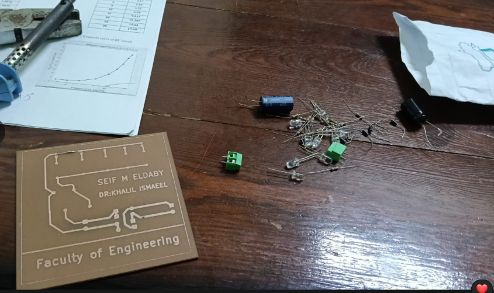
   <em>Step 6 — Drilled PCB alongside kitted THT components prior to assembly</em>

---

### 3.7 Component Placement & Hand Soldering
Components were populated on the top side and hand-soldered on the bottom copper layer using a temperature-controlled iron and tin-lead rosin-core solder, aiming for clean, concave fillets. Flux residue was removed afterward using **Isopropyl Alcohol (IPA)**.

<table>
  <tr>
    <td align="center" width="50%">
      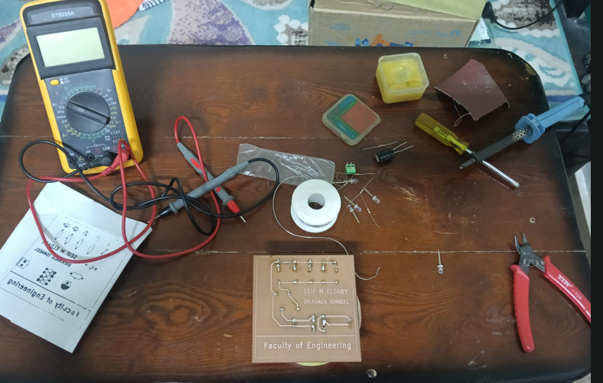 
      <em>Step 7a — Completed solder joints on the bottom copper layer</em>
    </td>
    <td align="center" width="50%">
      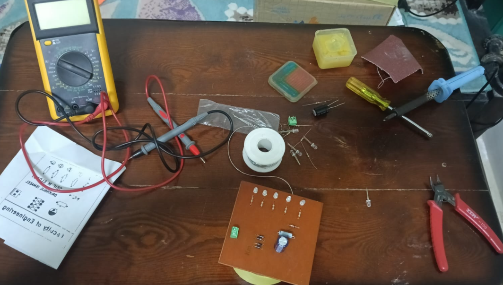 
      <em>Step 7b — Final assembled component side on the workbench</em>
    </td>
  </tr>
</table>

---

### 3.8 CAD-to-Hardware Alignment Check
Placing the completed physical PCB directly beside the original KiCad 3D model confirms accurate footprint alignment, component spacing, and overall build quality.

  
   <em>Step 8 — Fabricated hardware compared side-by-side with the KiCad 3D model</em>

---

## ✅ Stage 4 — Board Bring-Up & Final Verification

For safe initial power-up, the board was energized through an isolation transformer. Output regulation and branch currents were verified with a multimeter, and all five infrared LED channels illuminated uniformly (visible through the camera sensor).

  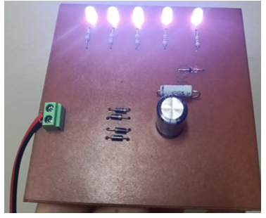
   <em>Final Result — All five IR LED channels operating under regulated 9.1 V DC</em>

| Verification Metric | Target | Verified Result |
| :--- | :--- | :--- |
| Regulated Output Voltage | $9.1\text{ V}$ | ✅ $9.1\text{ V}$ |
| LED Branch Current | ~$18.8\text{ mA}$ | ✅ Within spec |
| Output Ripple Voltage | ~$0.2\text{ V}_{\text{p-p}}$ | ✅ Well-smoothed |
| Zener Power Dissipation | $\le 1.0\text{ W}$ | ✅ $\le 0.82\text{ W}$ max |
| Operational Channels | 5 / 5 IR LEDs | ✅ 5 / 5 Active |

---

## 📁 Repository Structure

~~~text
📦 AC-DC-LED-Driver-PCB
 ┣ 📂 images/                   <- Complete fabrication, KiCad, and LTspice visual log
 ┣ 📄 README.md                 <- Hardware lifecycle & PCB fabrication documentation
 ┗ 📄 LED_Driver_PCB_Report.pdf <- Full academic technical report (calculations & BOM)
~~~

---

## 👤 Author

**Seif Elden Mostafa Salah Eldaby**  
Electrical & Electronics Engineering — Assiut University (Class of 2029)  
**Supervisor:** Dr. Khalil Ismail — Faculty of Engineering, Assiut University

---

## 📄 License

Submitted as academic work at Assiut University. Open for educational reference with proper attribution.
